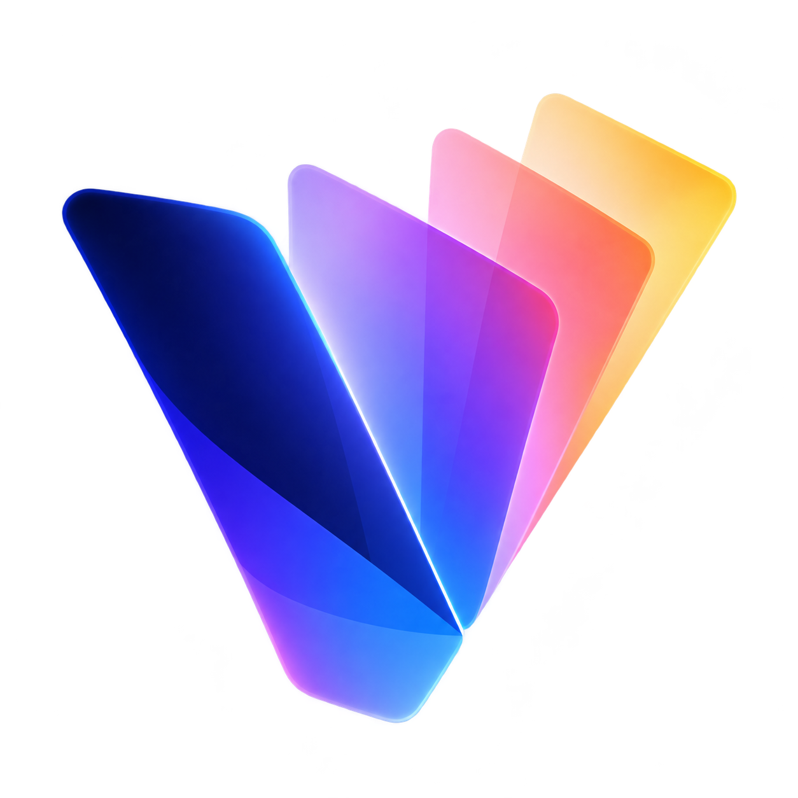

<p align="center">
  
</p>

<h1 align="center">Viscraft</h1>

<p align="center">
  <strong>Create Freely. Keep It Editable.</strong><br>
  <em>An open-ended creative studio for coding agents.</em>
</p>

<p align="center">
  <strong>Editable Designs · Video Creation &amp; Editing · Playable Worlds</strong>
</p>

Viscraft helps Codex, Claude Code, and other Skill-capable agents create and refine visual work. Start with an idea, existing media, or a reference, and let your agent choose the creative methods your project needs—from editable design and animation to video editing, generative shots, and playable worlds.

## Why Viscraft?

### Extend your agent's creativity—not constrain it

Viscraft is **capability-first, not pipeline-first**. Your agent can write code, use tools and skills it already knows, and combine or invent approaches as your project requires. It doesn't have to follow a prescribed sequence just to edit a poster, recut a clip, or try a different way to make a shot. That means **less time working around rigid workflows and more freedom to experiment, adapt, and refine**. Creative decisions stay with you and your agent; the Runtime handles dependable execution, project state, review, and delivery. Safety checks and permissions still apply where needed.

### Start with an idea—or something you already have

Start from scratch, **edit existing footage**, or **adapt a reference**. Bring videos, images, audio, or an existing Viscraft project. Your agent can recut and polish your material, or study a reference video's pacing, composition, and observable motion to guide a new creation using your own assets. Reference adaptation is creative guidance, not automatic frame-for-frame reconstruction of the original or its editable project.

### Create end to end, across media

A project can begin as a **fully editable poster or key visual**, carry its design assets into code animation and video, combine those with generated or existing footage, then move through editing, sound, and final delivery. The same project may also include an interactive world. These are **connected possibilities, not mandatory steps**: you can start at any point, finish with a single medium, or build several deliverables from shared creative work.

### Truly editable designs—not just generated images

Create posters, key visuals, and graphics as **editable design documents** with real text, layers, and layout—not only flattened image outputs. Adjust them in the image Workbench, deliver the source, or reuse their assets in animations and videos. Imported raster images do not automatically become editable layers.

### From first frame to final cut

**Create with code and generative AI.** Use code-driven animation for precise graphics, timing, and motion; use video models for shots that benefit from generative visuals. Mix both with 3D renders and existing footage, choosing the right method for each shot.

**Plan with motion proxies.** Your agent can use code, Blender, Three.js, or recorded interactions to plan camera moves and action. When a video model supports the required reference inputs, a proxy can help guide generation. Proxy guidance is optional and does not guarantee exact motion transfer.

**Edit and finish.** Cut, rearrange, retime, and composite existing or generated footage. Refine transitions, titles, subtitles, color, and sound on a shared timeline. Revise the parts that changed and reuse unaffected results where possible.

### Playable worlds—not just rendered scenes

Create interactive scenes you can explore, play, and record. A world can be its own deliverable, a source of footage, or a space for planning cameras and movement.

### Keep creating, not starting over

Your work lives in an **editable project**. Return to it, make targeted changes, preserve accepted results, and hand it off so someone else can continue. You don't need to recreate everything just to change one part.

## Start creating

### 1. Install the Skill

**With your agent** — send this to Codex, Claude Code, or another Skill-capable coding agent:

```text
Install the Viscraft Skill from:
https://github.com/yunncheng/Viscraft/tree/main/skills/viscraft
Check and prepare its matching Runtime and the tools needed for my work.
```

<details>
<summary><strong>With a command</strong> — requires Node.js 22.20+</summary>

```sh
npx skills add yunncheng/Viscraft --skill viscraft -g
```

Choose your coding agent when prompted. For Codex specifically, append `--agent codex`; `-g` makes the Skill available across your projects. The [Skills installer](https://github.com/vercel-labs/skills) handles installation.

</details>

The agent checks for a matching Runtime and prepares the tools needed for your task. You don't need to select a production pipeline or build Viscraft yourself. The Runtime requires Node.js 22+; other tools and model services are used only when needed. See [Contributing](CONTRIBUTING.md#development) for development setup.

### 2. Tell your agent what to make

Open your agent in the folder where you want to work. You can begin anywhere—for example:

**Create across media**

> Use Viscraft to turn these product photos into a fully editable launch poster and a 20-second promotional video. Reuse the design where it makes sense, combine code animation and generated shots as needed, and finish the video with sound. Deliver both works and the editable project.

**Edit or adapt existing footage**

> Use Viscraft to recut these clips into a short promo, drawing on the pacing and framing of this reference video. Keep my own footage and branding, improve the titles and sound, and leave the result open to later edits.

**Build something playable**

> Use Viscraft to create an interactive 3D showroom I can explore and record. Deliver the playable experience and its project.

### 3. Refine it together

Ask for changes in ordinary language: “Keep the opening, shorten the ending, and replace the last line. Leave the other shots as they are.” You can also edit a design in its Workbench and continue with your agent. Viscraft reuses unaffected results where possible rather than rebuilding everything.

## Models and optional tools

You don't need a generation model for every project. Editable design, code animation, and editing existing footage can work without one; AI video requires a supported service and may incur charges. Proxy guidance depends on the inputs supported by that service.

See [model setup](skills/viscraft/references/providers/setup.md#setup-steps-for-the-user) and [supported model guides](skills/viscraft/references/providers/model-guides.md). **Enter API keys locally, not in chat.** Configuration does not automatically authorize spending or uploading assets.

## Output and handoff

Finished media and an editable project for film, image, and sound work are delivered under `output/handoff/`. Share the outputs or pass on the project to keep editing. See [delivery and project handoff](skills/viscraft/references/runtime/delivery.md) for formats, attribution, and continuation instructions.

## Documentation

Keep the Skill and Runtime on matching releases. Installing the Skill does not include external tools, model accounts, or credits.

[Creative references](skills/viscraft/references/creative-references.md) · [Model setup](skills/viscraft/references/providers/setup.md#setup-steps-for-the-user) · [Delivery and continuing projects](skills/viscraft/references/runtime/delivery.md) · [Skill instructions](skills/viscraft/SKILL.md) · [Contributing](CONTRIBUTING.md#development)

## Acknowledgements

Viscraft builds on the work of these open-source projects:

- [huashu-art-motion](https://github.com/alchaincyf/huashu-art-motion) and [lemo-opuscar](https://github.com/lemomo-ai/lemo-opuscar): selected visual and sound reference implementations, adapted for Viscraft's authoring contracts.
- [Editable-Design](https://github.com/yejy53/Editable-Design): the layer editor adapted for Viscraft's image Workbench.
- [Taste Skill](https://github.com/Leonxlnx/taste-skill) and [Impeccable](https://github.com/pbakaus/impeccable): selected design guidance adapted for the Viscraft Skill.

We also thank the font and recording creators credited with the bundled resources. Exact adopted files, modifications, copyright notices, and licence texts are recorded in [third-party notices](THIRD_PARTY_NOTICES.md) and each reference's `LICENSES.md`.

## License

Viscraft's own code, documentation, and bundled original case media use [Apache-2.0](LICENSE), including commercial use, modification, and redistribution under its terms, without separate permission or payment. Third-party code, fonts, and recordings retain their original licences and notices; see [third-party notices](THIRD_PARTY_NOTICES.md) and each reference's `LICENSES.md`.

This licence covers Viscraft's distribution; it does not automatically license your own projects or grant trademark rights.

A finished work's own licences and attribution travel with its editable handoff. When reusing code, fonts, recordings, or melodies, retain their applicable rights and notices, including when code generates the final sound.
